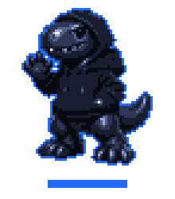

I build AI agents, MCP connectors and automations that people actually use every day.

📍 Colombia

 

### ⚡ What I build

- **AI agents & assistants** — Claude-powered tools that read, decide and act across real systems.
- **MCP connectors** — custom servers that give AI models safe access to apps, data and workflows.
- **Automations** — lead capture, scheduling, WhatsApp flows, reports: the repetitive work, gone.
- **Full-stack products** — from idea to production, deployed and maintained.

### 🦖 Featured — Terry

My personal operating system, built with AI.
A PWA that runs my finances, habits, projects, study plans and reminders, with gamified progress (XP, streaks, achievements) and push notifications.
It ships with its own **MCP connector (40+ tools)**, so Claude can manage everything from my Mac or my phone.

`Next.js` `TypeScript` `PostgreSQL` `MCP` `Railway`

### 🧰 Stack

  

**AI:** Claude · Claude Code · Model Context Protocol (MCP) · Prompt & agent design

### 📫 Contact

